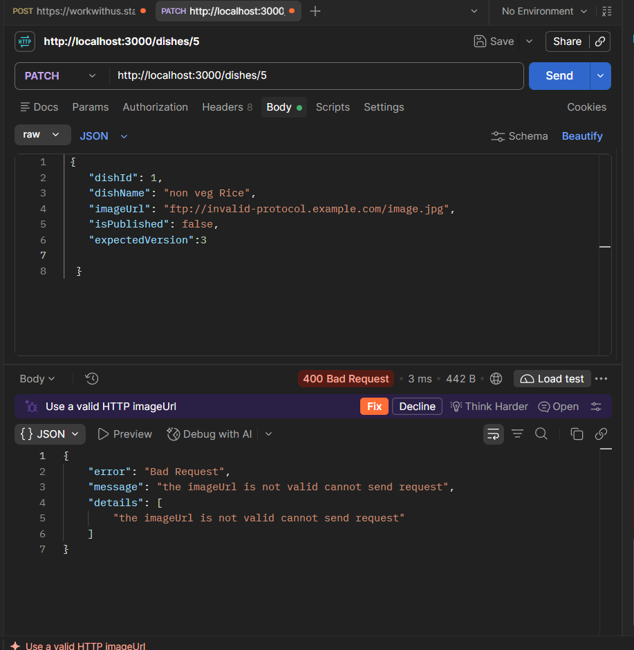

# 🍽️ Nosh Dish Dashboard

**Draft Editing & Safe Updates with Optimistic Concurrency Control**

A full-stack dish management dashboard that lets restaurant operators view, edit and publish dishes with instant local drafts, real-time background sync, and safe concurrent editing powered by optimistic locking.


---

## Table of Contents

- [Features](#features)
- [Screenshots](#screenshots)
- [Tech Stack](#tech-stack)
- [Project Structure](#project-structure)
- [Prerequisites](#prerequisites)
- [Getting Started](#getting-started)
  - [1. Clone the Repository](#1-clone-the-repository)
  - [2. Install Dependencies](#2-install-dependencies)
  - [3. Configure Environment](#3-configure-environment)
  - [4. Seed the Database](#4-seed-the-database)
  - [5. Run the Application](#5-run-the-application)
- [Migrations](#migrations)
- [Seeding & Reseeding](#seeding--reseeding)
- [Available Scripts](#available-scripts)
- [API Reference](#api-reference)
- [Verification Steps](#verification-steps)
- [Invalid Image URL Test](#invalid-image-url-test)
- [Architecture](#architecture)
- [Background Polling & Synchronization Lifecycle](#background-polling--synchronization-lifecycle)
- [Design Decisions](#design-decisions)
- [Known Limitations](#known-limitations)
- [Time Spent](#time-spent)
- [AI & Reused-Code Disclosure](#ai--reused-code-disclosure)

---

## Features

- **Dish Grid View** — Responsive card grid displaying all dishes with images, names, publish status, and version badges
- **Single Dish View** — Deep-link to any dish via `/dishes/:dishId`
- **Inline Draft Editing** — Edit dish name and toggle publish status locally; changes are tracked as unsaved drafts
- **Dirty State Tracking** — Visual indicators (amber border, "Unsaved" badge) clearly show which fields have pending changes
- **Explicit Save / Discard** — Save and Discard buttons appear only when the card is dirty
- **Optimistic Concurrency Control** — Every `PATCH` sends the client's `expectedVersion`; the server bumps the version atomically and rejects stale writes with HTTP 409
- **Conflict Resolution UI** — On a 409 conflict the card shows the server's current version and lets the user reload the latest, discarding their draft
- **Background Polling** — The frontend polls the server every 5 seconds; when a newer version is detected while the user has a draft, an info banner offers to reload
- **Graceful Pause** — Polling pauses automatically when the browser tab is hidden and resumes on focus
- **Validation Errors** — The backend validates all fields and returns structured 400 errors that the frontend renders inline
- **Image Fallback** — A built-in SVG placeholder is shown when a dish image fails to load
- **Skeleton Loading** — Shimmer skeleton cards are displayed while data is being fetched
- **Client-Side Routing** — Lightweight `pushState` router with `/, /dishes, /dishes/:dishId` routes and a 404 fallback

---

## Screenshots

| Home | Dishes Grid |
|------|-------------|
|  |  |

| Single Dish Detail | Draft Editing (Dirty State) |
|--------------------|----------------------------|
|  |  |
| Conflict in Versions | Validation Check |
|--------------------|----------------------------|
|  |  |
| Invalid Image URL |
|--------------------|
|  |

---

## Tech Stack

| Layer | Technology |
|-------|-----------|
| **Frontend** | React 19, Vite 8 |
| **Backend** | Node.js, Express 4 |
| **Database** | SQLite via `better-sqlite3` (WAL mode) |
| **Concurrency** | Optimistic locking with row-level versioning |

---

## Project Structure

```
nosh-dish-dashboard/
├── assets/                        # Screenshots for README
├── backend/
│   ├── data/
│   │   ├── dishes.json            # Seed data (5 dishes)
│   │   └── dishes_invalid_image.json  # Test data: dish with invalid image URL
│   ├── scripts/
│   │   └── seed.js                # Idempotent seeder (INSERT OR IGNORE)
│   └── src/
│       ├── app.js                 # Express app setup (CORS, routes, error handler)
│       ├── server.js              # HTTP server entry point
│       ├── controllers/
│       │   └── dishController.js  # Route handlers
│       ├── db/
│       │   ├── connection.js      # SQLite connection & schema init
│       │   └── dishRepository.js  # Data access layer (atomic update)
│       ├── middleware/
│       │   └── errorHandler.js    # Centralised error middleware
│       ├── routes/
│       │   └── dishRoutes.js      # GET / GET :id / PATCH :id
│       └── services/
│           └── dishService.js     # Business logic & validation
├── frontend/
│   ├── src/
│   │   ├── App.jsx                # Root layout and view coordinator
│   │   ├── main.jsx               # React DOM entry
│   │   ├── index.css              # All styles
│   │   ├── components/
│   │   │   ├── DishCard.jsx       # Individual dish card with draft editing
│   │   │   ├── DishGrid.jsx       # Grid layout, loading skeletons, empty state
│   │   │   ├── ErrorBanner.jsx    # Reusable error/info/conflict banner
│   │   │   ├── StatusBadge.jsx    # Version, published, draft, unsaved badges
│   │   │   └── ToggleSwitch.jsx   # Styled toggle for publish status
│   │   ├── hooks/
│   │   │   ├── useDishDraft.js    # Draft state, save, discard, conflict logic
│   │   │   ├── useDishPolling.js  # Live sync, draft-aware auto-refresh, lifecycle cleanup
│   │   │   └── useRouter.js       # Client-side history pushState routing
│   │   └── services/
│   │       └── api.js             # Fetch wrappers, ApiError class
│   └── vite.config.js
├── scripts/
│   ├── dev.js                     # Starts backend + frontend concurrently
│   └── resetDb.js                 # Wipes and re-seeds the database
├── .env.example                   # Reference env vars
├── .gitignore
└── package.json                   # Root workspace scripts
```

---

## Prerequisites

- **Node.js** ≥ 20.19 (Vite 8 requires Node 20.19+; older versions such as 18 will not work)
- **npm** ≥ 9

> `better-sqlite3` ships pre-built binaries for most platforms. If your platform requires compilation you will also need Python 3 and a C++ toolchain.

---

## Getting Started

### 1. Clone the Repository

```bash
git clone https://github.com/VinitAgarwal21/Nosh-Dish-Dashboard.git
cd Nosh-Dish-Dashboard
```

### 2. Install Dependencies

A single command installs root, backend, and frontend dependencies:

```bash
npm install
```

### 3. Configure Environment

Copy the example env files:

```bash
# Root (optional, values used by scripts/dev.js)
cp .env.example .env

# Backend
cp backend/.env.example backend/.env

# Frontend
cp frontend/.env.example frontend/.env
```

Default values work out of the box — no changes required for local development:

| Variable | Default | Description |
|----------|---------|-------------|
| `PORT` | `3000` | Express server port |
| `DB_PATH` | `./data/nosh.db` | SQLite database file path (relative to `backend/`) |
| `CORS_ORIGIN` | `http://localhost:5173` | Allowed CORS origin |
| `VITE_API_BASE_URL` | `http://localhost:3000` | Backend URL used by the frontend |

### 4. Seed the Database

```bash
npm run seed
```

This loads the 5 dishes from [`backend/data/dishes.json`](backend/data/dishes.json) into SQLite.

> **Idempotent:** The seeder uses `INSERT OR IGNORE` keyed on `dishId`. Running `npm run seed` multiple times will **never duplicate dishes** and will **never overwrite or reset** dishes that you have already edited. Only dishes whose `dishId` is missing from the table are inserted.

### 5. Run the Application

```bash
npm run dev
```

This starts both the backend (port 3000) and frontend (port 5173) concurrently.

Open your browser at **http://localhost:5173**.

---

## Migrations

No separate migration step is needed. The schema is created automatically on first start in [`backend/src/db/connection.js`](backend/src/db/connection.js). The `initSchema` function runs `CREATE TABLE IF NOT EXISTS` every time the database connection is initialised, so the table is always present before any queries execute.

---

## Seeding & Reseeding

### `npm run seed` — Safe & Additive

- Reads `backend/data/dishes.json` (5 dishes).
- Uses **`INSERT OR IGNORE`** — only inserts dishes whose `dishId` does not already exist in the database.
- **Will not duplicate** existing dishes on repeated runs.
- **Will not overwrite** edited dish names, publish states, or version numbers.

```
$ npm run seed
[Seed] Processing 5 dishes from seed file...
[Seed] Seeding complete: 0 inserted, 5 skipped.   ← all 5 already exist
```

### `npm run seed:reset` — Full Reset

- **Deletes all rows** from the `dishes` table (`DELETE FROM dishes`).
- Re-runs the seeder to insert all 5 dishes fresh with `version = 1`.
- Use this only when you want a clean slate.

```
$ npm run seed:reset
[Reset] Existing dishes cleared.
[Seed] Seeding complete: 5 inserted, 0 skipped.
```

---

## Available Scripts

All scripts are run from the **project root**:

| Script | Command | Description |
|--------|---------|-------------|
| **Install all** | `npm install` | Installs root, backend, and frontend dependencies |
| **Seed** | `npm run seed` | Idempotent seed — inserts missing dishes only |
| **Reset + Seed** | `npm run seed:reset` | Wipes all dishes and re-seeds from JSON |
| **Dev** | `npm run dev` | Starts backend (watch mode) + frontend (Vite HMR) |
| **Start** | `npm run start` | Starts backend only (production) |

---

## API Reference

Base URL: `http://localhost:3000`

### `GET /dishes`

Returns all dishes sorted by `dishId`.

**Response** `200 OK`

```json
[
  {
    "dishId": "1",
    "dishName": "Jeera Rice",
    "imageUrl": "https://nosh-assignment.s3.ap-south-1.amazonaws.com/jeera-rice.jpg",
    "isPublished": true,
    "version": 1
  }
]
```

### `GET /dishes/:dishId`

Returns a single dish.

**Response** `200 OK` | `404 Not Found`

### `PATCH /dishes/:dishId`

Updates `dishName` and `isPublished` with optimistic locking.

**Request Body**

```json
{
  "dishName": "Jeera Rice (Updated)",
  "isPublished": true,
  "expectedVersion": 1
}
```

**Responses**

| Status | Meaning |
|--------|---------|
| `200` | Update succeeded — returns the updated dish with `version` incremented |
| `400` | Validation error — missing or invalid fields |
| `404` | Dish not found |
| `409` | **Conflict** — `expectedVersion` does not match the current row version. Response includes `currentDish` with the latest server state |

**409 Conflict Response**

```json
{
  "error": "Conflict",
  "message": "Conflict: Dish has been modified by another update",
  "currentDish": {
    "dishId": "1",
    "dishName": "Jeera Rice",
    "imageUrl": "https://...",
    "isPublished": true,
    "version": 3
  }
}
```

---

## Verification Steps

Below are the exact steps used to verify each acceptance case.

### 1. Drafts and Discard

1. Open `http://localhost:5173/dishes`.
2. Click a dish name to edit it — type a new name. Observe the amber "Unsaved" badge and border.
3. Click **Discard**. The name reverts to the server value; the amber indicators disappear.

### 2. Save and Persistence After Refresh and Backend Restart

1. Edit a dish name, then click **Save**. The card shows the updated name with an incremented version badge.
2. Refresh the page (`F5`). Confirm the saved name persists.
3. Stop the backend (`Ctrl+C` in the terminal running `npm run dev`), then restart it (`npm run dev`). Refresh the page again. The dish still shows the updated name — SQLite data survives restarts.

### 3. Reseeding

```bash
# After editing dishes, run seed again:
npm run seed
# Expected output: 0 inserted, 5 skipped — your edits are preserved.

# Full reset:
npm run seed:reset
# All dishes revert to their original seed values with version = 1.
```

### 4. Empty Name Publish

```bash
curl -X PATCH http://localhost:3000/dishes/1 \
  -H "Content-Type: application/json" \
  -d '{"dishName": "", "isPublished": true, "expectedVersion": 1}'
```

**Expected:** HTTP 400 with `"dishName cannot be empty when dish is published"` in the `details` array. The dish is unchanged.

### 5. Two-Tab Conflict

1. Open `http://localhost:5173/dishes` in **Tab A** and **Tab B**.
2. In Tab A, edit dish 1's name and click **Save** → succeeds, version becomes 2.
3. In Tab B (still showing version 1), edit dish 1's name and click **Save**.
4. Tab B receives a **409 Conflict** banner displaying the server's current version.
5. Click **Reload latest** in Tab B to accept the server state.

### 6. Backend Unavailable with Retry

1. Stop the backend server.
2. In the browser, try to edit and save a dish. The frontend shows a network error banner: _"Unable to reach backend server"_ or _"Network connection failed"_.
3. Restart the backend. Refresh the page or wait for the next poll (≤ 5 s). Dishes load normally.

### 7. Unknown Dish ID

```bash
curl -s http://localhost:3000/dishes/999
```

**Expected:** HTTP 404 with `"Dish with ID \"999\" not found"`.

```bash
curl -X PATCH http://localhost:3000/dishes/999 \
  -H "Content-Type: application/json" \
  -d '{"dishName": "Ghost", "isPublished": false, "expectedVersion": 1}'
```

**Expected:** HTTP 404.

### 8. Invalid Input

```bash
# Missing expectedVersion
curl -X PATCH http://localhost:3000/dishes/1 \
  -H "Content-Type: application/json" \
  -d '{"dishName": "Test"}'

# Expected: HTTP 400 — "isPublished must be a boolean", "expectedVersion must be an integer …"

# Non-integer expectedVersion
curl -X PATCH http://localhost:3000/dishes/1 \
  -H "Content-Type: application/json" \
  -d '{"dishName": "Test", "isPublished": true, "expectedVersion": "abc"}'

# Expected: HTTP 400 — "expectedVersion must be an integer …"
```

---

## Invalid Image URL Test

A test data file [`backend/data/dishes_invalid_image.json`](backend/data/dishes_invalid_image.json) contains a dish with an `ftp://` image URL (an intentionally invalid protocol):

```json
[
  {
    "dishId": "99",
    "dishName": "Bad Image Dish",
    "imageUrl": "ftp://invalid-protocol.example.com/image.jpg",
    "isPublished": false
  }
]
```

### How to seed and test

```bash
# 1. Seed the invalid-image dish directly into the database
#    (the regular seed script reads dishes.json, so we insert manually via curl after
#     importing via a one-off seed or by editing the main file temporarily)
#
#    Easiest approach — temporarily point the seed script at the test file:
cd backend
node -e "
  const { getDb } = require('./src/db/connection');
  const db = getDb();
  db.prepare(
    'INSERT OR IGNORE INTO dishes (dishId, dishName, imageUrl, isPublished, version) VALUES (?, ?, ?, ?, ?)'
  ).run('99', 'Bad Image Dish', 'ftp://invalid-protocol.example.com/image.jpg', 0, 1);
  console.log('Inserted dish 99');
"
cd ..
```

```bash
# 2. Attempt to publish the dish (set isPublished to true)
curl -X PATCH http://localhost:3000/dishes/99 \
  -H "Content-Type: application/json" \
  -d '{"dishName": "Bad Image Dish", "isPublished": true, "expectedVersion": 1}'
```

**Expected response:** HTTP 400

```json
{
  "error": "Validation failed for publishing dish",
  "details": ["imageUrl must be a valid HTTP or HTTPS URL to publish"]
}
```

The dish remains unchanged (`isPublished = false`, `version = 1`) because the server validates `imageUrl` before allowing publish.

```bash
# 3. Verify the dish was not modified
curl -s http://localhost:3000/dishes/99
# Confirm: isPublished is still false, version is still 1
```

```bash
# 4. Clean up — remove the test dish
cd backend
node -e "
  const { getDb } = require('./src/db/connection');
  const db = getDb();
  db.prepare('DELETE FROM dishes WHERE dishId = ?').run('99');
  console.log('Deleted dish 99');
"
cd ..
```

---

## Architecture

```
┌─────────────────────┐          ┌──────────────────────────┐
│     React (Vite)    │  fetch   │     Express Backend      │
│                     │ ───────► │                          │
│  App.jsx            │ ◄─────── │  GET  /dishes            │
│    ├ DishGrid       │  JSON    │  GET  /dishes/:id        │
│    │  └ DishCard    │          │  PATCH /dishes/:id       │
│    └ useDishDraft() │          │                          │
│                     │          │  dishService.js           │
│  • Local draft state│          │    └ Validation           │
│  • Background poll  │          │  dishRepository.js        │
│  • Conflict UI      │          │    └ Atomic UPDATE ... WHERE│
│                     │          │      version = ?          │
└─────────────────────┘          └────────┬─────────────────┘
                                          │
                                 ┌────────▼─────────────────┐
                                 │   SQLite (better-sqlite3) │
                                 │   WAL mode, row versioning│
                                 │                           │
                                 │  dishes                   │
                                 │  ├ dishId   TEXT PK       │
                                 │  ├ dishName TEXT           │
                                 │  ├ imageUrl TEXT           │
                                 │  ├ isPublished INTEGER     │
                                 │  └ version  INTEGER        │
                                 └───────────────────────────┘
```

### Optimistic Locking Flow

1. Client loads dish → receives `version: N`
2. User edits name / toggles publish → local draft only
3. User clicks **Save** → `PATCH /dishes/:id` with `expectedVersion: N`
4. Server runs inside a transaction:
   - `UPDATE dishes SET ... WHERE dishId = ? AND version = N`
   - If `changes === 1` → success, returns dish with `version: N+1`
   - If `changes === 0` → row exists but version differs → **409 Conflict** with the current server dish
5. Client on 409 → shows conflict banner → user clicks **Reload latest** to accept the server version

---

## Background Polling & Synchronization Lifecycle

The dashboard maintains near-real-time synchronization with the backend through background polling encapsulated in [`frontend/src/hooks/useDishPolling.js`](frontend/src/hooks/useDishPolling.js).

### 1. Update Delay & Auto-Refresh Behavior
- **Polling interval:** The client requests latest dish data every **5 seconds** (`POLL_INTERVAL_MS = 5000`).
- **Cards without drafts:** When a dish is updated externally (e.g. from another browser tab or direct API calls), cards without unsaved edits are **refreshed automatically** on screen on the next poll cycle without any user interaction.
- **Cards with drafts:** If the user has active, uncommitted edits on a card (`isDirty === true`), incoming server updates will **not overwrite** their work. Instead, the card displays an informative banner (*"External Update Available: Another update saved this dish as v..."*) allowing the user to either discard and reload the latest version or continue editing.
- **Immediate fetch on focus:** When a user switches back to an inactive browser tab, a fresh poll is dispatched immediately so the view syncs without waiting for the full 5-second interval.

### 2. Timer and Listener Cleanup
- **`setInterval` cleanup:** The polling timer ID is preserved in a `pollTimerRef`. When the component unmounts or the user navigates away from dish routes (such as navigating back to the Home page), the cleanup function runs `clearInterval(pollTimerRef.current)`.
- **Visibility listener cleanup:** A `visibilitychange` listener is attached to `document` to pause polling when the tab is hidden (conserving network bandwidth and device resources). When leaving the view, `document.removeEventListener('visibilitychange', handleVisibilityChange)` is called, guaranteeing no orphaned listeners or memory leaks.

### 3. Handling Temporary Disconnections
- **Graceful degradation:** If a background poll fails due to network loss or temporary backend unavailability, the `catch` block catches the network failure without throwing errors to the user and switches `syncStatus` to `'reconnecting'`.
- **Visual status indicator:** The header displays an amber status pill (*"Reconnecting..."*) indicating background attempts are active.
- **Automatic recovery:** The polling loop keeps retrying at 5-second intervals. As soon as connectivity or the backend restarts, the poll succeeds and smoothly transitions `syncStatus` back to `'connected'` (*"Live sync active"*), refreshing cards automatically.
- **Safe error handling on save:** If a user submits a save while disconnected, `updateDish` catches the network error, sets `inlineError`, and displays a clear retryable error banner on the card without destroying or resetting the user's uncommitted draft.

---

## Design Decisions

### Why Optimistic Locking with a Version Check

I chose optimistic locking over pessimistic locking (e.g., database row locks or application-level mutex) for two main reasons:

1. **Concurrency without blocking.** In a dashboard where multiple restaurant operators may view and occasionally edit dishes at the same time, pessimistic locks would force users to wait for each other. With optimistic locking, every user can freely edit locally. Only at save time does the server check whether the underlying data has changed. In the common case — no conflict — the update goes through instantly with zero waiting.

2. **Simplicity and statelessness.** The version column is a single integer stored alongside the dish. The server doesn't need to track open sessions, manage lock expiry timers, or handle abandoned locks. The entire check-and-bump happens in one atomic `UPDATE ... WHERE version = ?` statement inside a transaction, which means there are no race conditions and no leftover state if a user closes their browser mid-edit.

The trade-off is that on a genuine conflict the user must discard their draft and re-apply changes on top of the latest version. In practice, for a dish management dashboard with low write contention, this is a rare and acceptable cost.

---

## Known Limitations

- **No authentication or authorisation.** Any user with network access can read and modify dishes. A production deployment would need role-based access control.
- **No image upload.** Dish images are URLs stored as text; there is no upload endpoint or file-storage integration.
- **Polling instead of WebSockets.** The frontend polls every 5 seconds. For faster real-time updates (e.g., collaborative editing), WebSockets or Server-Sent Events would be more efficient.
- **No pagination or search.** All dishes are fetched in a single `GET /dishes` call. This works for small catalogues but would need pagination for thousands of dishes.
- **SQLite single-writer limitation.** SQLite uses a single-writer model. Under very high concurrent write loads, a client-server database (PostgreSQL, MySQL) would perform better.
- **No undo after save.** Once a save succeeds the previous state is overwritten. An audit log or soft-delete mechanism would allow rollback.
- **Image URL not editable.** The `PATCH` endpoint only accepts `dishName` and `isPublished`; `imageUrl` cannot be changed through the API.
- **No automated tests included.** The project does not include a test suite (unit/integration). Adding Jest or Vitest tests would improve confidence for future changes.

---

## Time Spent

**Approximate total: 4-5 hours**

---

## AI & Reused-Code Disclosure

- **AI tools used:** GitHub Copilot and Google Gemini (Antigravity) were used for code scaffolding, writing boilerplate (Express setup, Vite config), drafting CSS styles, and refining this README.
- **What AI was used for:** Auto-completing repetitive patterns, generating initial component structures, CSS styling assistance, and documentation drafting. All generated code was reviewed, tested, and modified manually.
- **Reused code / libraries:** No third-party component libraries were used beyond the npm packages listed in `package.json` (React, Vite, Express, better-sqlite3, dotenv, cors, concurrently). The project is written from scratch without copying from starter kits or existing repositories.

---
