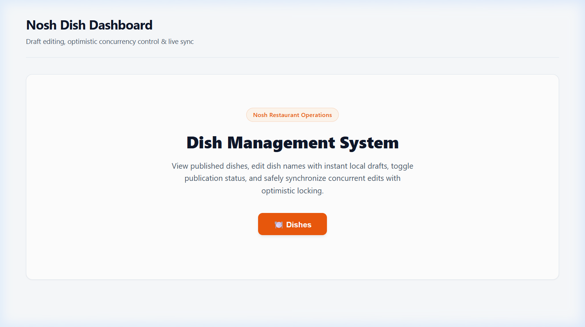
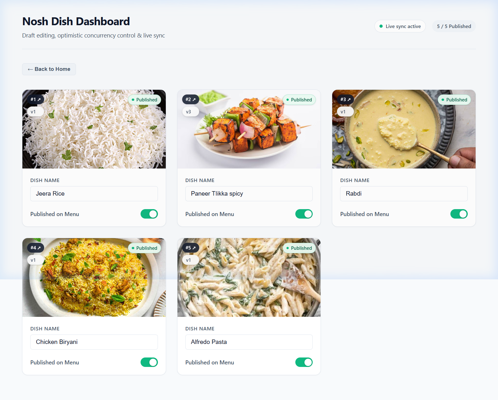
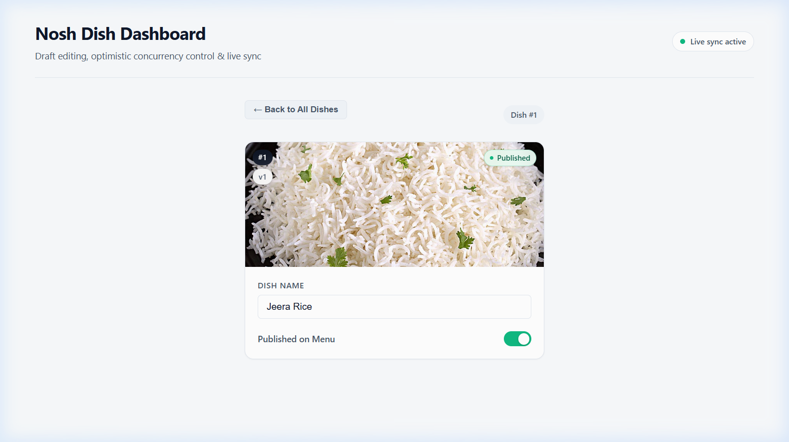
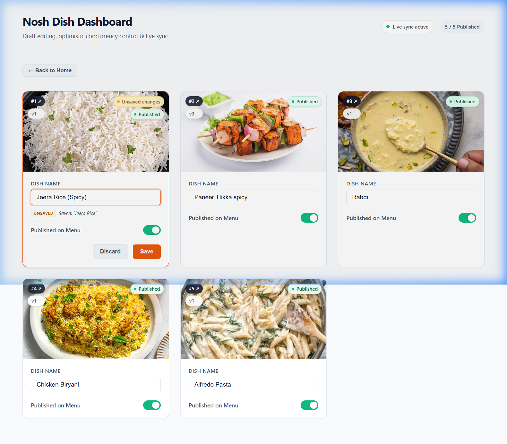
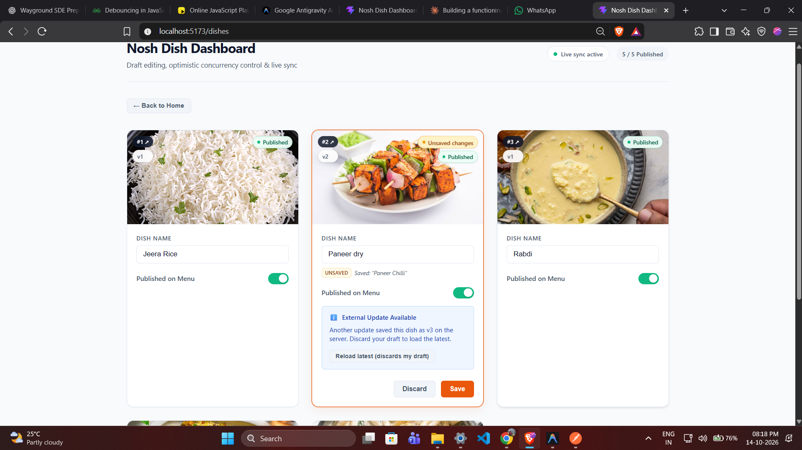
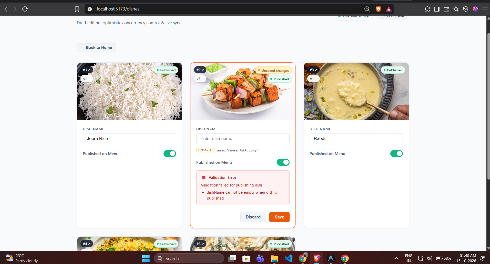

# 🍽️ Nosh Dish Dashboard

**Draft Editing & Safe Updates with Optimistic Concurrency Control**

A full-stack dish management dashboard that lets restaurant operators view, edit and publish dishes with instant local drafts, real-time background sync, and safe concurrent editing powered by optimistic locking.



---

## Table of Contents

- [Features](#features)
- [Screenshots](#screenshots)
- [Tech Stack](#tech-stack)
- [Project Structure](#project-structure)
- [Prerequisites](#prerequisites)
- [Getting Started](#getting-started)
  - [1. Clone the Repository](#1-clone-the-repository)
  - [2. Install Dependencies](#2-install-dependencies)
  - [3. Configure Environment](#3-configure-environment)
  - [4. Seed the Database](#4-seed-the-database)
  - [5. Run the Application](#5-run-the-application)
- [Seeding & Reseeding](#seeding--reseeding)
- [Available Scripts](#available-scripts)
- [API Reference](#api-reference)
- [Architecture](#architecture)

---

## Features

- **Dish Grid View** — Responsive card grid displaying all dishes with images, names, publish status, and version badges
- **Single Dish View** — Deep-link to any dish via `/dishes/:dishId`
- **Inline Draft Editing** — Edit dish name and toggle publish status locally; changes are tracked as unsaved drafts
- **Dirty State Tracking** — Visual indicators (amber border, "Unsaved" badge) clearly show which fields have pending changes
- **Explicit Save / Discard** — Save and Discard buttons appear only when the card is dirty
- **Optimistic Concurrency Control** — Every `PATCH` sends the client's `expectedVersion`; the server bumps the version atomically and rejects stale writes with HTTP 409
- **Conflict Resolution UI** — On a 409 conflict the card shows the server's current version and lets the user reload the latest, discarding their draft
- **Background Polling** — The frontend polls the server every 5 seconds; when a newer version is detected while the user has a draft, an info banner offers to reload
- **Graceful Pause** — Polling pauses automatically when the browser tab is hidden and resumes on focus
- **Validation Errors** — The backend validates all fields and returns structured 400 errors that the frontend renders inline
- **Image Fallback** — A built-in SVG placeholder is shown when a dish image fails to load
- **Skeleton Loading** — Shimmer skeleton cards are displayed while data is being fetched
- **Client-Side Routing** — Lightweight `pushState` router with `/, /dishes, /dishes/:dishId` routes and a 404 fallback

---

## Screenshots

| Home | Dishes Grid |
|------|-------------|
|  |  |

| Single Dish Detail | Draft Editing (Dirty State) |
|--------------------|----------------------------|
|  |  |
| Conflict in Versions | Validation Check |
|--------------------|----------------------------|
|  |  |


---

## Tech Stack

| Layer | Technology |
|-------|-----------|
| **Frontend** | React 19, Vite 8 |
| **Backend** | Node.js, Express 4 |
| **Database** | SQLite via `better-sqlite3` (WAL mode) |
| **Concurrency** | Optimistic locking with row-level versioning |

---

## Project Structure

```
nosh-dish-dashboard/
├── assets/                        # Screenshots for README
├── backend/
│   ├── data/
│   │   └── dishes.json            # Seed data (5 dishes)
│   ├── scripts/
│   │   └── seed.js                # Idempotent seeder (INSERT OR IGNORE)
│   └── src/
│       ├── app.js                 # Express app setup (CORS, routes, error handler)
│       ├── server.js              # HTTP server entry point
│       ├── controllers/
│       │   └── dishController.js  # Route handlers
│       ├── db/
│       │   ├── connection.js      # SQLite connection & schema init
│       │   └── dishRepository.js  # Data access layer (atomic update)
│       ├── middleware/
│       │   └── errorHandler.js    # Centralised error middleware
│       ├── routes/
│       │   └── dishRoutes.js      # GET / GET :id / PATCH :id
│       └── services/
│           └── dishService.js     # Business logic & validation
├── frontend/
│   ├── src/
│   │   ├── App.jsx                # Root component, router, polling
│   │   ├── main.jsx               # React DOM entry
│   │   ├── index.css              # All styles
│   │   ├── components/
│   │   │   ├── DishCard.jsx       # Individual dish card with draft editing
│   │   │   ├── DishGrid.jsx       # Grid layout, loading skeletons, empty state
│   │   │   ├── ErrorBanner.jsx    # Reusable error/info/conflict banner
│   │   │   ├── StatusBadge.jsx    # Version, published, draft, unsaved badges
│   │   │   └── ToggleSwitch.jsx   # Styled toggle for publish status
│   │   ├── hooks/
│   │   │   └── useDishDraft.js    # Draft state, save, discard, conflict logic
│   │   └── services/
│   │       └── api.js             # Fetch wrappers, ApiError class
│   └── vite.config.js
├── scripts/
│   ├── dev.js                     # Starts backend + frontend concurrently
│   └── resetDb.js                 # Wipes and re-seeds the database
├── .env.example                   # Reference env vars
├── .gitignore
└── package.json                   # Root workspace scripts
```

---

## Prerequisites

- **Node.js** ≥ 18 (LTS recommended)
- **npm** ≥ 9

> `better-sqlite3` ships pre-built binaries for most platforms. If your platform requires compilation you will also need Python 3 and a C++ toolchain.

---

## Getting Started

### 1. Clone the Repository

```bash
git clone <repository-url>
cd nosh-dish-dashboard
```

### 2. Install Dependencies

A single command installs root, backend, and frontend dependencies:

```bash
npm run install:all
```

### 3. Configure Environment

Copy the example env files:

```bash
# Root (optional, values used by scripts/dev.js)
cp .env.example .env

# Backend
cp backend/.env.example backend/.env

# Frontend
cp frontend/.env.example frontend/.env
```

Default values work out of the box — no changes required for local development:

| Variable | Default | Description |
|----------|---------|-------------|
| `PORT` | `3000` | Express server port |
| `DB_PATH` | `./data/nosh.db` | SQLite database file path (relative to `backend/`) |
| `CORS_ORIGIN` | `http://localhost:5173` | Allowed CORS origin |
| `VITE_API_BASE_URL` | `http://localhost:3000` | Backend URL used by the frontend |

### 4. Seed the Database

```bash
npm run seed
```

This loads the 5 dishes from [`backend/data/dishes.json`](backend/data/dishes.json) into SQLite.

> **Idempotent:** The seeder uses `INSERT OR IGNORE` keyed on `dishId`. Running `npm run seed` multiple times will **never duplicate dishes** and will **never overwrite or reset** dishes that you have already edited. Only dishes whose `dishId` is missing from the table are inserted.

### 5. Run the Application

```bash
npm run dev
```

This starts both the backend (port 3000) and frontend (port 5173) concurrently.

Open your browser at **http://localhost:5173**.

---

## Seeding & Reseeding

### `npm run seed` — Safe & Additive

- Reads `backend/data/dishes.json` (5 dishes).
- Uses **`INSERT OR IGNORE`** — only inserts dishes whose `dishId` does not already exist in the database.
- **Will not duplicate** existing dishes on repeated runs.
- **Will not overwrite** edited dish names, publish states, or version numbers.

```
$ npm run seed
[Seed] Processing 5 dishes from seed file...
[Seed] Seeding complete: 0 inserted, 5 skipped.   ← all 5 already exist
```

### `npm run seed:reset` — Full Reset

- **Deletes all rows** from the `dishes` table (`DELETE FROM dishes`).
- Re-runs the seeder to insert all 5 dishes fresh with `version = 1`.
- Use this only when you want a clean slate.

```
$ npm run seed:reset
[Reset] Existing dishes cleared.
[Seed] Seeding complete: 5 inserted, 0 skipped.
```

---

## Available Scripts

All scripts are run from the **project root**:

| Script | Command | Description |
|--------|---------|-------------|
| **Install all** | `npm run install:all` | Installs root, backend, and frontend dependencies |
| **Seed** | `npm run seed` | Idempotent seed — inserts missing dishes only |
| **Reset + Seed** | `npm run seed:reset` | Wipes all dishes and re-seeds from JSON |
| **Dev** | `npm run dev` | Starts backend (watch mode) + frontend (Vite HMR) |
| **Start** | `npm run start` | Starts backend only (production) |

---

## API Reference

Base URL: `http://localhost:3000`

### `GET /dishes`

Returns all dishes sorted by `dishId`.

**Response** `200 OK`

```json
[
  {
    "dishId": "1",
    "dishName": "Jeera Rice",
    "imageUrl": "https://nosh-assignment.s3.ap-south-1.amazonaws.com/jeera-rice.jpg",
    "isPublished": true,
    "version": 1
  }
]
```

### `GET /dishes/:dishId`

Returns a single dish.

**Response** `200 OK` | `404 Not Found`

### `PATCH /dishes/:dishId`

Updates `dishName` and `isPublished` with optimistic locking.

**Request Body**

```json
{
  "dishName": "Jeera Rice (Updated)",
  "isPublished": true,
  "expectedVersion": 1
}
```

**Responses**

| Status | Meaning |
|--------|---------|
| `200` | Update succeeded — returns the updated dish with `version` incremented |
| `400` | Validation error — missing or invalid fields |
| `404` | Dish not found |
| `409` | **Conflict** — `expectedVersion` does not match the current row version. Response includes `currentDish` with the latest server state |

**409 Conflict Response**

```json
{
  "error": "Conflict",
  "message": "Conflict: Dish has been modified by another update",
  "currentDish": {
    "dishId": "1",
    "dishName": "Jeera Rice",
    "imageUrl": "https://...",
    "isPublished": true,
    "version": 3
  }
}
```

---

## Architecture

```
┌─────────────────────┐          ┌──────────────────────────┐
│     React (Vite)    │  fetch   │     Express Backend      │
│                     │ ───────► │                          │
│  App.jsx            │ ◄─────── │  GET  /dishes            │
│    ├ DishGrid       │  JSON    │  GET  /dishes/:id        │
│    │  └ DishCard    │          │  PATCH /dishes/:id       │
│    └ useDishDraft() │          │                          │
│                     │          │  dishService.js           │
│  • Local draft state│          │    └ Validation           │
│  • Background poll  │          │  dishRepository.js        │
│  • Conflict UI      │          │    └ Atomic UPDATE ... WHERE│
│                     │          │      version = ?          │
└─────────────────────┘          └────────┬─────────────────┘
                                          │
                                 ┌────────▼─────────────────┐
                                 │   SQLite (better-sqlite3) │
                                 │   WAL mode, row versioning│
                                 │                           │
                                 │  dishes                   │
                                 │  ├ dishId   TEXT PK       │
                                 │  ├ dishName TEXT           │
                                 │  ├ imageUrl TEXT           │
                                 │  ├ isPublished INTEGER     │
                                 │  └ version  INTEGER        │
                                 └───────────────────────────┘
```

### Optimistic Locking Flow

1. Client loads dish → receives `version: N`
2. User edits name / toggles publish → local draft only
3. User clicks **Save** → `PATCH /dishes/:id` with `expectedVersion: N`
4. Server runs inside a transaction:
   - `UPDATE dishes SET ... WHERE dishId = ? AND version = N`
   - If `changes === 1` → success, returns dish with `version: N+1`
   - If `changes === 0` → row exists but version differs → **409 Conflict** with the current server dish
5. Client on 409 → shows conflict banner → user clicks **Reload latest** to accept the server version

---
